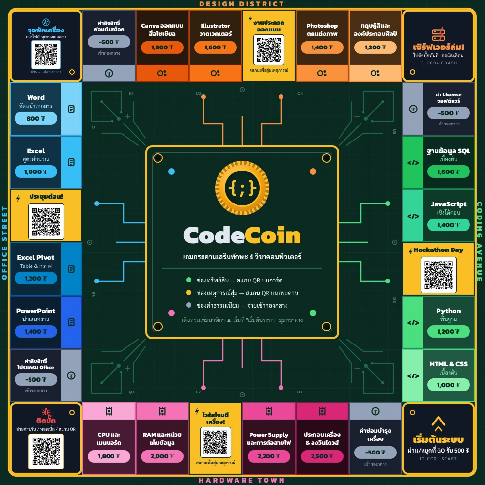
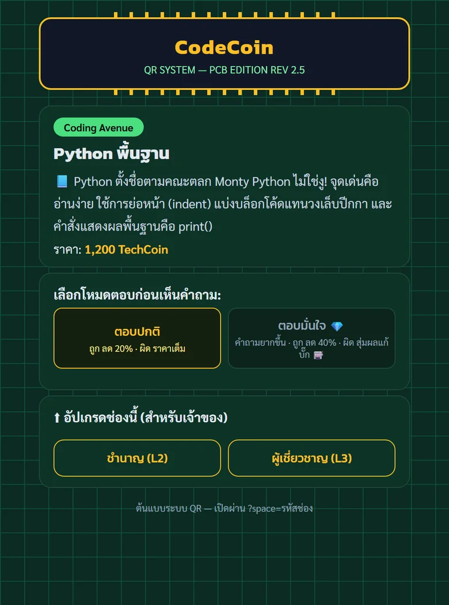
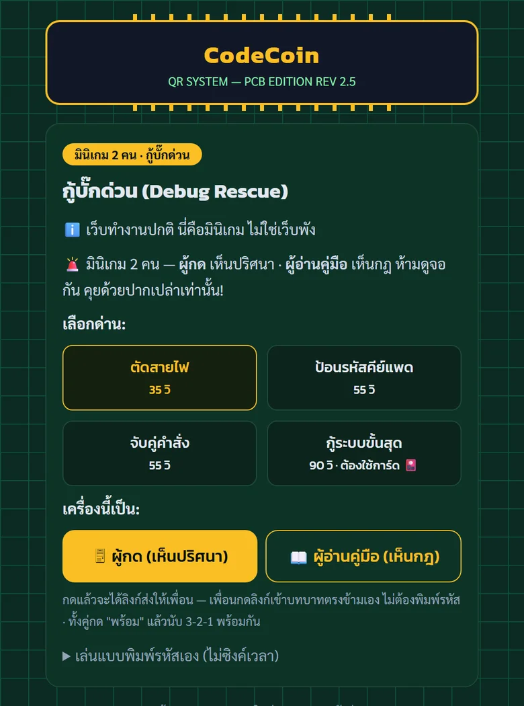
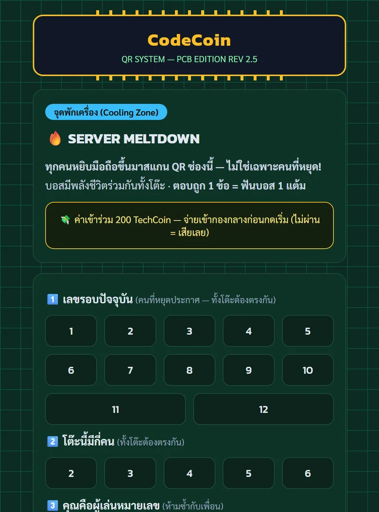

# CodeCoin 🪙

**บอร์ดเกมการศึกษาที่ใช้มือถือสแกน QR เพื่อตอบคำถามคอมพิวเตอร์ 4 วิชา**
Coding · Microsoft Office · Graphic Design · การประกอบคอมพิวเตอร์

[**▶ เปิดเว็บแอปเกม**](https://ballg-it.github.io/codecoin/) &nbsp;·&nbsp;
[**📖 คู่มือกติกา (PDF)**](print/rulebook/%E0%B8%84%E0%B8%B9%E0%B9%88%E0%B8%A1%E0%B8%B7%E0%B8%AD%E0%B8%81%E0%B8%95%E0%B8%B4%E0%B8%81%E0%B8%B2_CodeCoin_A5.pdf) &nbsp;·&nbsp;
[**📦 ดูกล่องเกมแบบ 3 มิติ**](https://ballg-it.github.io/codecoin/box_demo/codecoin_box_demo_v4.html)

## CodeCoin คืออะไร

เกมกระดานแนวซื้อขายทรัพย์สิน (แบบ Monopoly) ที่ **ทุกการซื้อ อัปเกรด และออกจากคุก ต้องใช้ความรู้**
ผู้เล่นทอยเต๋าเดินบนกระดาน หยุดช่องไหนก็สแกน QR ของช่องนั้นด้วยมือถือ แล้วตอบคำถามหรือเล่นมินิเกมบนเว็บ

ไม่ต้องติดตั้งแอป ไม่ต้องล็อกอิน — มือถือเครื่องไหนสแกนแล้วเล่นได้เลย และเล่นต่อได้แม้เน็ตหลุด

| | |
|---|---|
| 👥 ผู้เล่น | 2–4 คน + Banker 1 คน |
| ⏱️ เวลาเล่น | ~50 นาที (1 คาบเรียน) · 12 รอบ |
| 🎯 จบเกม | ครบรอบแล้ววัดคะแนนรวม (เงินสด + มูลค่าทรัพย์สิน) หรือเล่นจนเหลือคนเดียว |
| 📱 ต้องมี | มือถือต่อเน็ตได้อย่างน้อย 1 เครื่อง (ดีที่สุดคนละเครื่อง) |

## เล่นยังไง

1. **ทอยเต๋า 2 ลูก** แล้วเดินตามแต้ม
2. **สแกน QR** ของช่องที่หยุด — บนการ์ดทรัพย์สินหรือบนกระดาน
3. **ทำตามที่เว็บบอก** แล้วจ่าย/รับเงิน TechCoin (₮) ตามผล

ช่องที่มี QR แต่ละแบบเปิดหน้าเว็บต่างกัน:

| ช่อง | เกิดอะไรขึ้น |
|---|---|
| 🏠 **ทรัพย์สิน** (16 ช่อง) | อ่านความรู้สั้น ๆ แล้วตอบคำถาม — ตอบถูกได้ส่วนลดตอนซื้อ · อัปเกรดช่องได้ด้วยคำถามที่ยากขึ้น |
| ⚡ **เหตุการณ์** (4 ช่อง) | สุ่มการ์ดเหตุการณ์ประจำโซน — บางใบให้ทั้งโต๊ะแข่งตอบเร็ว |
| 🐞 **ติดบั๊ก** | แก้โจทย์ debug แข่งกับเวลา ตอบถูก = ออกจากคุกฟรี |
| 🔥 **จุดพักเครื่อง** | บอสไฟต์ทั้งโต๊ะ — ทุกคนช่วยกันตอบคำถามฟันบอส · เข้ามินิเกม **กู้บั๊กด่วน** ได้จากหน้านี้ (2 คน 2 มือถือ คนหนึ่งเห็นปริศนา อีกคนเห็นคู่มือ ต้องคุยกันให้ผ่าน) |

ช่องค่าธรรมเนียม (จ่ายเข้ากองกลาง) และช่องเริ่มต้นระบบ (รับเงินเดือน) ไม่ต้องสแกน

กติกาเต็ม (การเตรียมเกม, ค่าเช่า, Crash Round, การชนะ) อยู่ใน [คู่มือกติกา PDF](print/rulebook/%E0%B8%84%E0%B8%B9%E0%B9%88%E0%B8%A1%E0%B8%B7%E0%B8%AD%E0%B8%81%E0%B8%95%E0%B8%B4%E0%B8%81%E0%B8%B2_CodeCoin_A5.pdf)

## หน้าตาบนมือถือ

<table>
  <tr>
    <td align="center" width="33%"> ช่องทรัพย์สิน — เลือกโหมดก่อนตอบ</td>
    <td align="center" width="33%"> กู้บั๊กด่วน — มินิเกม 2 คน</td>
    <td align="center" width="33%"> จุดพักเครื่อง — บอสไฟต์ทั้งโต๊ะ</td>
  </tr>
</table>

## ในกล่องมีอะไร

กระดาน 50×50 ซม. · การ์ดทรัพย์สิน 16 ใบ · การ์ดกู้ระบบขั้นสุด 1 ใบ · ธนบัตร TechCoin 200 ใบ (5 ราคา) · โทเค็น 4 ตัว · ลูกเต๋า 2 ลูก · คลิปบอกระดับ 24 ตัว · ถาดตั้งการ์ด · คู่มือกติกา

เนื้อหาในเว็บ: **คำถาม 81 ข้อ** · **การ์ดเหตุการณ์ 20 ใบ** · **โจทย์ Bug Jam 19 ข้อ** · **มินิเกม 4 ด่าน**

---

## อยากทำอะไร → ไปที่ไหน

| ฉันอยากจะ… | ไปที่ |
|---|---|
| เล่นเกม / ลองกดดูทุกช่องโดยไม่ต้องสแกน | [เว็บแอปเกม](https://ballg-it.github.io/codecoin/) (เปิดตรงจะเจอเมนูทดสอบ) |
| อ่านกติกา | [`print/rulebook/`](print/rulebook/) — เล่ม A5 12 หน้า |
| สั่งพิมพ์ชิ้นงาน | [`print/Final/`](print/Final/) — กระดาน + การ์ดหน้า/หลัง พร้อมส่งโรงพิมพ์ · ธนบัตรอยู่ [`print/banknotes/`](print/banknotes/) |
| แก้คำถาม / เนื้อหาเกม | `codecoin_database.xlsx` — ดูขั้นตอนด้านล่าง |
| แก้โค้ดเว็บ / สคริปต์ | [คู่มือนักพัฒนา](docs/DEVELOPER.md) — โครงสร้างไฟล์, URL ทุกหน้า, วิธีทดสอบ |
| ดูประวัติและสถานะโปรเจค | [`docs/PROJECT_SUMMARY.md`](docs/PROJECT_SUMMARY.md) |

### แก้คำถาม (สำหรับทีม content)

1. แก้ไฟล์ `codecoin_database.xlsx` (หัวตารางอยู่แถวที่ 2 — แถวแรกเป็นหมายเหตุ ห้ามลบ · ช่องเฉลยกรอก a/b/c/d)
2. รัน `py scripts/build_data.py` เพื่อสร้าง `data.json` ใหม่ (สคริปต์จะเตือนถ้าข้อมูลผิด)
3. push ขึ้น GitHub — เว็บอัปเดตเองใน ~1 นาที

> อย่าแก้ `data.json` ด้วยมือ ให้แก้ที่ Excel เสมอ

## ทำงานยังไง

- **เว็บ static ล้วน** — HTML ไฟล์เดียว + `data.json` host ฟรีบน GitHub Pages ไม่มี server หรือฐานข้อมูล
- **เล่นออฟไลน์ได้** — Service Worker เก็บแอปไว้ในเครื่อง เน็ตโรงเรียนล่มกลางคาบก็เล่นต่อได้ และติดตั้งเป็นแอปบนหน้าจอโฮมได้
- **กันโกง** — รีเฟรชหน้ากลางคำถามแล้วได้ข้อเดิม เวลาเดินต่อ · ตัวเลือกสลับตำแหน่งทุกครั้ง
- **มินิเกมหลายเครื่องโดยไม่มีเซิร์ฟเวอร์ของตัวเอง** — สองเครื่องใช้รหัสห้องร่วมกันสร้างปริศนาชุดเดียวกัน

CodeCoin — โปรเจคจบ · บอร์ดเกมเพื่อการศึกษา
